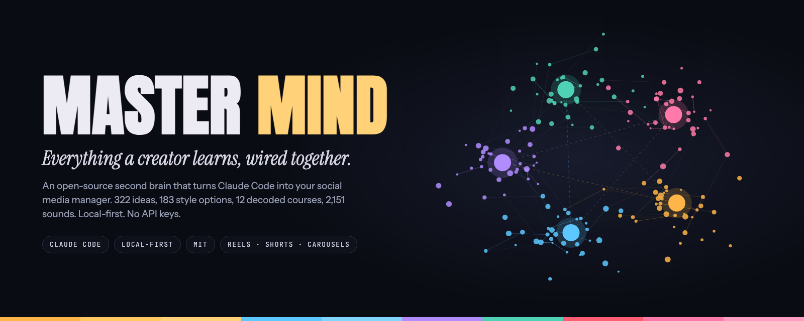
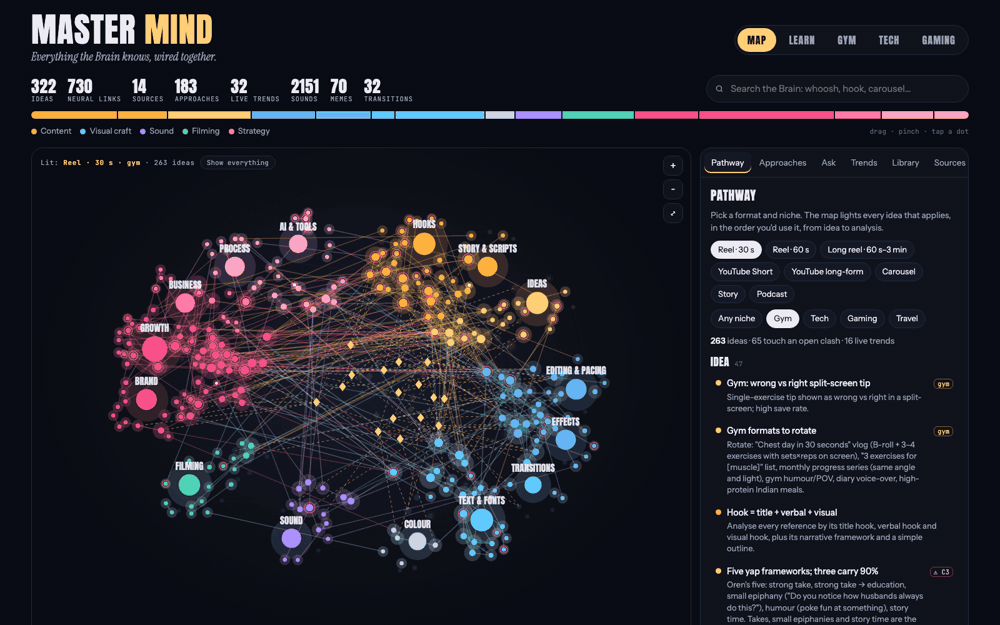
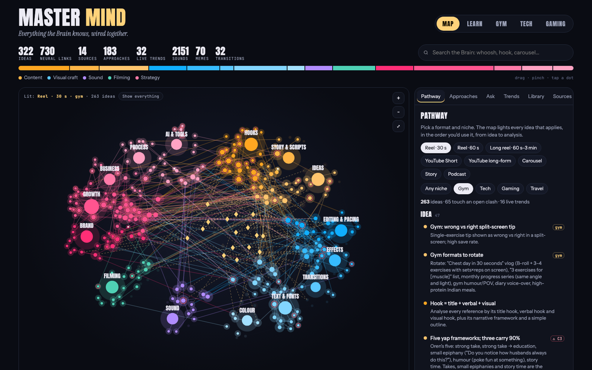
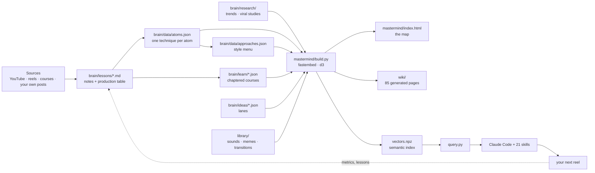

<p align="center">
  
</p>

<h1 align="center">Master Mind</h1>

<p align="center">
  <b>An open-source second brain that turns Claude Code into your social media manager.</b><br>
  Every video, reel and course you study gets decoded into one living map that Claude reads before it scripts, edits, sound-designs or audits your next post.<br>
  Runs on your laptop. No API keys. No subscriptions. No vidIQ.
</p>

<p align="center">
  <a href="https://srijxnj.github.io/mastermind/"></a>
  <a href="#quickstart"></a>
  <a href="https://github.com/SrijxnJ/mastermind/stargazers"></a>
</p>

<p align="center">
  
  
  
  
  
  
</p>

<p align="center">
  <a href="#what-you-get">What you get</a> ·
  <a href="#quickstart">Quickstart</a> ·
  <a href="#how-it-works">How it works</a> ·
  <a href="#the-skills">Skills</a> ·
  <a href="#make-it-yours">Make it yours</a> ·
  <a href="#whats-inside">What's inside</a> ·
  <a href="#credits">Credits</a>
</p>

<p align="center">
  
</p>

## Why this exists

Every creator watches hours of "how I went viral" videos and remembers none of it at 7 pm when the tripod is up.

Master Mind is what happened when one creator (928 followers, a desk job, a golden retriever) decided to stop re-watching and start **decoding**. Each source is broken into **atoms**: one technique each, with the quote that backs it, when to use it, how to do it in CapCut, Edits or ffmpeg, and which other atoms agree or disagree. A small embedding model wires them into a graph. Claude Code searches that graph before it answers anything, cites the atom ids, and writes what it learns back in.

The result is a social media manager that gets smarter every session, lives in a folder, and never phones home.

## What you get

<table>
<tr>
<td width="50%" valign="top">

**The Map**<br>
322 ideas from 14 sources in 15 topics, linked by 730 neural edges. Pick a format and a niche and the map lights every idea that applies, in the order you would use it: idea, script, film, edit, sound, graphics, publish, analyse.

</td>
<td width="50%" valign="top">

**Approaches, not verdicts**<br>
40 style dimensions with 183 options (hook type, caption style, SFX density, grade, CTA, pace). Where two experts disagree, the clash becomes a menu with "good at", "weak at" and "looks like", instead of a rule.

</td>
</tr>
<tr>
<td valign="top">

**Learn**<br>
12 long-form videos and courses (13.9 hours) rebuilt as visual courses: 119 chapters, frameworks drawn as diagrams, the best lines word for word, worked examples, quizzes and exercises per niche.

</td>
<td valign="top">

**Idea lanes**<br>
112 ready-to-shoot ideas across gym, tech and gaming, each with a hook line, storyboard, steps by phase, caption, hashtags, what you still need, and a safety note. Filter by format, difficulty and series.

</td>
</tr>
<tr>
<td valign="top">

**Viral research**<br>
308 creators and about 11,000 videos measured by **outlier multiple** (how far a video beat its own creator's normal), so a 50K-view reel from a 2K account ranks above a 2M-view reel from a 5M account. Title formulas that over-index and the ones that are saturated.

</td>
<td valign="top">

**Library and tools**<br>
2,151 CC0 sounds indexed with loudness and "use when", 70 meme sounds with frame timing, 32 transitions with ffmpeg and CapCut steps, 4 LUTs, a mixing guide. Local tools: Reel X-ray, Reel Doctor, auto-cut, text-behind-head, LUT maker.

</td>
</tr>
</table>

<p align="center"></p>

## Quickstart

```bash
git clone https://github.com/SrijxnJ/mastermind.git && cd mastermind
python3.11 -m venv .venv && .venv/bin/pip install -r requirements.txt
.venv/bin/python mastermind/build.py        # embeds the atoms, writes the map, the wiki and the search index
open mastermind/index.html                  # the Master Mind
```

Ask it something:

```bash
.venv/bin/python mastermind/query.py "30 second gym reel hook that is funny, not expert" -k 8
```

Then open the folder in Claude Code and talk to your manager:

```
claude
> I shot a leg day on a tripod. Give me three routes for a 30 s reel, with hooks, and say which goal each serves.
```

Claude reads `CLAUDE.md`, searches the Brain, lays out Route A, B and C with atom ids, and only renders the one you pick.

> The first build downloads a 130 MB sentence-embedding model (BAAI/bge-small-en-v1.5) once. Everything after that is offline.

## How it works



**An atom** is the unit of knowledge. It says what, when, how, who said it, and what it clashes with:

```json
{
  "id": "hook-contrast-looks-sounds",
  "title": "Contrast hook: looks X, sounds Y",
  "text": "Two-part contrast on screen: \"Looks pro. Sounds like this: 🔇\". Sets up the problem in one glance.",
  "how": "",
  "topic": "hooks",
  "stage": "script",
  "formats": [
    "reel30",
    "reel60",
    "reel90",
    "yt-short"
  ],
  "niches": [
    "all"
  ],
  "sources": [
    "L02"
  ],
  "evidence": "stated",
  "quote": "Looks pro. Sounds like this: 🔇",
  "clashes": []
}
```

`build.py` embeds every atom, approach option and trend, links each to its nearest neighbours, writes the page (template + data, one file), the wiki, and a vector index that `query.py` and the skills search locally.

## The skills

Drop into any Claude Code session from `.claude/skills/`. Each one searches the Brain first.

| Skill | What it does |
|---|---|
| `mastermind` | The manager. Searches the Brain, lays out routes with cited atoms, ingests new lessons, rebuilds the map. |
| `ig-reel` · `ig-carousel` · `ig-story` | Scripts, beat sheets and shot lists per format, hook scoring against a bank of 100+ templates. |
| `ig-caption` · `ig-human` | Caption packs in your voice, then a five-check pass that strips the machine fingerprint. |
| `ig-viral` · `ig-plan` | Outlier research on any niche, swipe files, a weekly plan that rotates formats. |
| `ig-audit` · `ig-profile` | Reads your insights, says what worked and why, scores the profile against a rubric. |
| `ig-comment` · `ig-reply` · `ig-dm` · `ig-repurpose` | Comments and replies that sound like you, one shoot into five posts. |
| `real-sfx` · `real-sound` · `earshot` | Sound design with real recordings placed on the exact frame, and a critic that listens back. |
| `hyperframes` · `hyperframes-cli` · `hyperframes-registry` · `media-use` | Motion graphics as code: titles, counters, HUDs rendered to video. |

Local tools in `tools/`: **Reel X-ray** (measures any reel's cuts, overlays, loudness, SFX), **Reel Doctor** (scores a draft against the Brain's rules, each citing its atom), auto-cut, text behind head, LUT generation, transcription, and a voice tool for your own voice only.

## Make it yours

1. **Fill in `SYSTEM_PROMPT.md`.** Who you are on camera, your lanes, your gear, your voice. Claude reads it every session.
2. **Keep the Brain, replace the lanes.** The atoms, approaches, courses and library are universal. Rename `brain/ideas/gym.json` to your niche and let Claude fill it from a viral study (`ig-viral`).
3. **Feed it.** Paste a YouTube link or a reel and say *"ingest this as a lesson"*. Claude writes the lesson, the atoms, the clashes, and rebuilds.
4. **Say "wrap up".** At the end of a session Claude saves what it learned (decisions, metrics, voice notes) back into the Brain, so the next session starts smarter.
5. **Your private parts stay private.** `brain/profile/`, `brain/voice/`, `brain/metrics/` and `posts/` are git-ignored by default. This repository is one creator's real Brain with exactly those folders removed.

## What's inside

```
mastermind/
├── mastermind/          build.py · template.html · query.py · index.html (the map, one file)
├── brain/
│   ├── data/            atoms.json · approaches.json (the knowledge)
│   ├── learn/           12 decoded courses (JSON, see SCHEMA.md)
│   ├── lessons/         raw notes per source, with production tables
│   ├── ideas/           gym · tech · gaming lanes
│   ├── research/        trends.json · viral/ (three outlier studies) · RESEARCHER.md
│   └── creators/        deep studies of single creators
├── library/             catalog.json (2,151 sounds) · memes · transitions · luts · mixing
├── wiki/                85 generated pages: topics, pathways, niches, sources, approaches, clashes
├── tools/               xray.py · doctor.py · autocut.sh · text_behind.py · luts.py · transcribe.py · voice.py
├── .claude/skills/      21 skills
├── docs/                the live demo (GitHub Pages) and screenshots
├── CLAUDE.md            how Claude runs this folder
└── SYSTEM_PROMPT.md     your persona (template)
```

Sound files themselves are not in the repository (39 MB of CC0 audio); `library/catalog.json` has every source URL and `library/tools/` rebuilds the pack.

## Credits

The Brain stands on the shoulders of people who teach in public. Every atom links to its source; the sources with the most atoms are Caleb Ralston, Oren John, Tristan Workman, Harry Dry, Kallaway's hook work, and the study of @rahulmhinduja. Lessons summarise and cite; they do not reproduce.

Skills and tools by others, kept with their licences: the `ig-*` skills by Jake Schincariol (MIT), `hyperframes` (Apache 2.0), `earshot` by Leon Lin (MIT), `uisfx` by Romain Simon (CC0). Sounds: OpenGameArt and Kenney (CC0). Fonts: Anton and Instrument Serif (SIL OFL). The map is drawn with d3; embeddings by fastembed.

Built by [Srijan Jaiswal](https://www.instagram.com/srijan_jaiswall/) with Claude Code, in Pune, between sets.

## License

MIT. Third-party pieces keep their own licences next to them; see `LICENSE`.

<p align="center">
  <a href="https://star-history.com/#SrijxnJ/mastermind&Date"></a>
</p>
